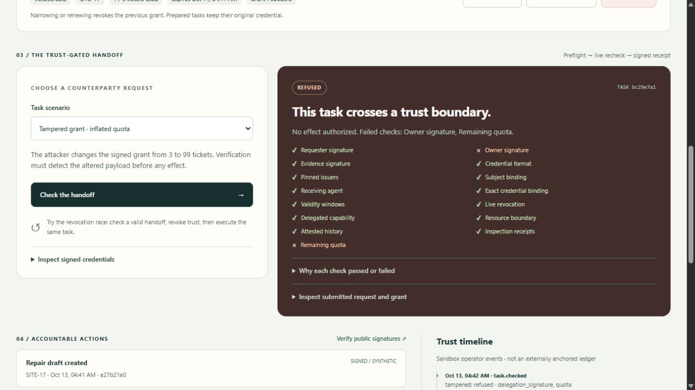
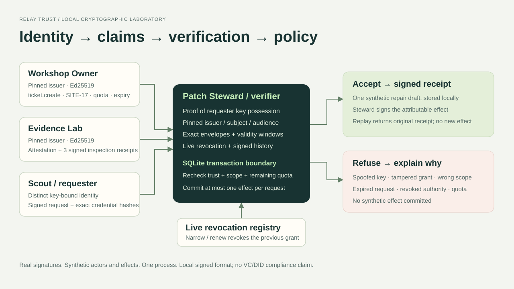

<div align="center">


# Relay Trust

**Authority with evidence, at the action boundary.**

[Live demo](https://relay-trust-agent-lab.choggyacc.chatgpt.site) · [90s video](docs/relay-trust-walkthrough.mp4) · [Architecture](docs/architecture.md) · [Thesis](docs/thesis.md) · [Walkthrough script](docs/walkthrough.md)
</div>

Scout asks Patch Steward to create a synthetic repair ticket. Steward checks real Ed25519 signatures, issuer-attested action history, and a narrow delegation before acting. A valid name or reputation number alone cannot authorize a task.

Built for [DOO: The Agent That Earns Trust](https://build.doo.ooo/challenges/agent-earns-trust). The named agents, inspection history, and effects are explicitly synthetic. Cryptographic signatures and key separation are real.

## Run from a clean clone

Use Node.js 24 or later. The local prototype has **no third-party dependencies or API keys**.

```sh
git clone https://github.com/m7mdd77/relay-trust.git
cd relay-trust
npm run check
npm start
```

Open **http://127.0.0.1:3250**. A new clone generates fresh server-side keys and SQLite state in ignored `.local/`. Keep the server running. To use another port in PowerShell: `$env:PORT='3251'; npm start`.

> [!IMPORTANT]
> Never publish `.local/`, database files, keys, session cookies, or mutation tokens. The local server is deliberately loopback-bound. The public companion uses isolated visitor sandboxes instead of exposing this local operator console.

## Try the trust boundary

1. **Valid repair ticket → Check → Execute:** one synthetic ticket and a Steward-signed receipt.
2. **Repeat execution:** the original receipt returns; no duplicate effect.
3. **Out of scope:** authentic Scout cannot delete a site with `ticket.create` authority.
4. **Spoofed Scout / tampered grant:** a wrong requester key or altered signed quota fails cryptographic verification.
5. **Revocation race:** prepare a valid request, revoke the grant, then execute. The live check blocks it.
6. **Narrow to one ticket:** one task succeeds and the next fails quota. Renewal and narrowing revoke the old grant.

The UI exposes fifteen checks and the submitted signed envelopes. Browser WebCrypto independently verifies public credentials and receipts. Self-reported “999 successful jobs” is deliberately ignored.



## Source and verification

| Path | Purpose |
| --- | --- |
| `server.js`, `src/` | Dependency-free Node/SQLite implementation |
| `public/` | Responsive browser demo |
| `test/` | 39 local cryptographic, persistence, and HTTP tests |
| `hosted/` | Full Sites/Vinext/D1 companion source and lockfile |
| `hosted/test/` | 13 hosted API/isolation/concurrency tests |
| `docs/` | Architecture, failure evidence, 252-word thesis, walkthrough |
| `tools/verify-public.js` | Offline public-evidence integrity verifier |

Local checks:

```sh
npm run check
node --test hosted/test/*.test.js
```

The published Worker was separately exercised: independent visitors, cross-visitor denial, five concurrent executions producing one signed receipt, revocation after approval, all adversarial fixtures, key-free export, and identity rotation. Desktop and mobile layouts were verified.

For the hosted companion, see [its README](hosted/README.md). Its own dependencies are required for builds. The Site ID is intentionally absent from this repository so a clone cannot accidentally target the author's existing deployment. Its D1 schema and generated migration are included.

## Identity → claims → verification → policy

Owner signs scoped authority. Evidence Lab signs three seeded synthetic inspection receipts and an attestation. Scout signs a request that commits to the exact credential hashes. Steward checks pinned issuers, subject, audience, validity, revocation, history, scope, and quota.

Local effects commit with a fresh policy check inside SQLite `BEGIN IMMEDIATE`. Hosted effects use a D1 revision guard: any competing effect or revocation forces a reload and reevaluation. A database-time deadline guard prevents a fresh hosted effect after expiry. Replay is keyed by the stored signed request ID.



## AI usage and limits

OpenAI Codex assisted with scenario design, implementation, tests, documentation, publication preparation, and browser verification. The original fixture lab needs no model. The independent local agents use the existing private AgentRouter configuration through the actual supported Claude Code client. Model proposals cannot bypass deterministic authorization.

- The fixture lab simulates agents. The live local AI section runs Scout and Steward in separate Node processes, each retaining its own signing key and calling DeepSeek V4 Flash through AgentRouter. The hosted Worker exposes the verified public transcript, without the owner model key.
- Issuers are pinned synthetic roots; signatures establish origin/integrity, not real-world identity or the truth of a claim.
- New grants and attestations carry W3C VC 2.0 / Data Integrity `eddsa-jcs-2022` proofs with Ed25519 `did:key` identifiers. The verifier passes the published W3C B.3 vector. Legacy sessions may retain the original format; renew or start fresh.
- Public visitors control only their own synthetic sandbox. Keys stay server-side in private D1 state; sessions last 24 hours and active sessions are capped at 256.
- The operator timeline is not an immutable external ledger. Hosting administrators can access stored keys; production key management is outside scope.
- No actual site repair, external tool action, account transaction, money transfer, or revenue is claimed.

The walkthrough video uses captioned verified UI captures. It is labeled as a capture-based walkthrough, not a continuous live screencast.

## Standards and live independent AI agents

See [standards and agent setup](docs/standards-and-agents.md) and [the actual verified AI run](docs/independent-ai-agents.json). Set `RELAY_AGENT_ENV` to an existing private `.env` file before `npm start`. The key stays out of source. Use the local live section for Run AI handoff → Execute → Replay → Spoof → Prepare → Revoke → Execute.

The local app includes a continuous 90-second browser recorder, requiring selection of only the Relay Trust tab in the browser sharing picker. The earlier published video remains captioned captures until a new continuous capture is completed and verified.
