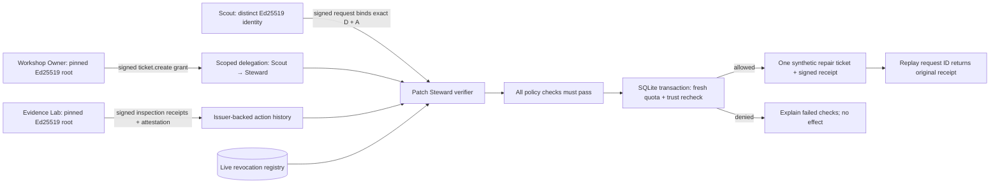

# Architecture snapshot

**Identity → claims → verification → policy:** identity is a SHA-256 fingerprint of an Ed25519 public key. Claims separately express the owner's authority and the lab's observed synthetic history. Verification establishes issuer and subject binding, proof of requester key possession, audience, exact credential hashes, validity, live revocation, and signed history integrity. Policy requires ticket.create on SITE-17 and available quota. Self-reported reputation is irrelevant.

**Attack boundary:** Mirror can copy Scout's name, identifier, public key, signed claims, and high reputation number. Without Scout's private key its request signature fails. Changing a grant invalidates the owner signature; a valid key does not authorize a different capability or recipient. Initial acceptance conveys no irrevocable execution authority.

**Execution boundary:** `BEGIN IMMEDIATE` serializes the authoritative recheck, quota query, receipt insert, and event. Each signed request is stored before execution; receipt `decision_id` is unique. Revocation before this boundary blocks a task. Revocation after a committed effect cannot undo it; subsequent replay only returns history. Owner renewal/narrowing revokes the old grant instead of mutating a signed credential. A narrowed grant inherits the same capability/resource/audience and a reduced quota.

**Local operator boundary:** owner and lab custody share a process with the agent fixtures; public roots come from the local registry. Browser requests only select test cases. Session token, Origin/Host gates, CSP, input validation, loopback binding, and body/rate limits reduce browser-driven local abuse. They do not establish a real owner login or protect against machine compromise.

**Storage and disclosure:** SQLite stores private identities, public envelopes, revocation flags, prepared tasks, receipts, settings, and timeline events. Only public identities/envelopes/receipts/events leave the server. The export omits private keys and the mutation token. Signed history is independently verifiable; timeline events and revocation state are trusted local state, not signed external facts.

## Standards and independent AI runtime

New authority and evidence carry W3C VC 2.0 documents secured with `eddsa-jcs-2022` proofs. Ed25519 `did:key` identifiers resolve locally to Multikey assertion methods; the proof binds the exact application claims and pinned issuer key. The published W3C B.3 proof and both canonicalization hashes pass. The original local envelope is retained as an application transport and for legacy sessions, with a signed profile marker preventing downgrade of new credentials.

The independent AI section starts separate Scout and Steward Node processes. Each retains its own signing key and invokes the actual supported AgentRouter client with `deepseek-v4-flash`. The controller receives public identities and signed messages, and retains the synthetic owner/lab roots. Model text is advisory; Steward verifies authority before preparation and execution. The controller serializes operations and supplies current revocation/quota state. This local IPC trust assumption does not establish OS account isolation or an independently administered remote authority service.

The public Worker hosts interactive fixture flows, standard credentials, the verified AI evidence, and the live recording. The independently running model agents operate locally with a server-only key. The public site does not expose that paid inference endpoint.
